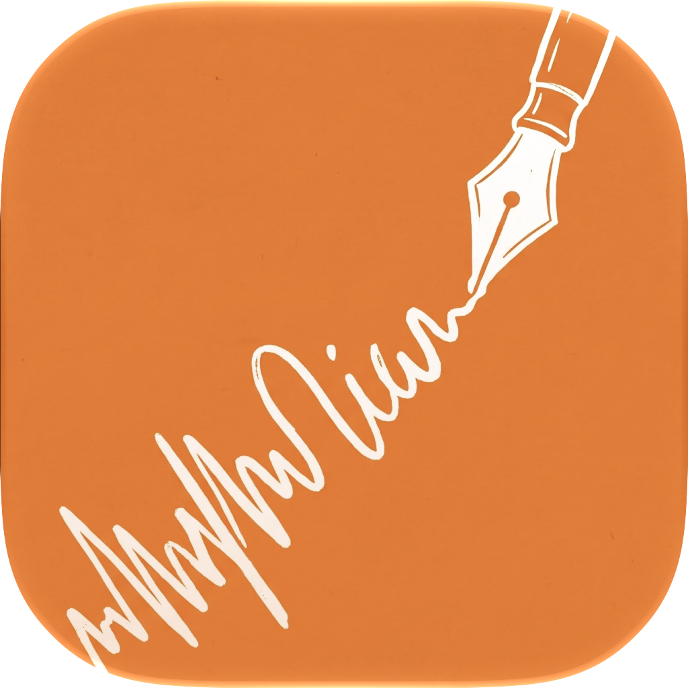
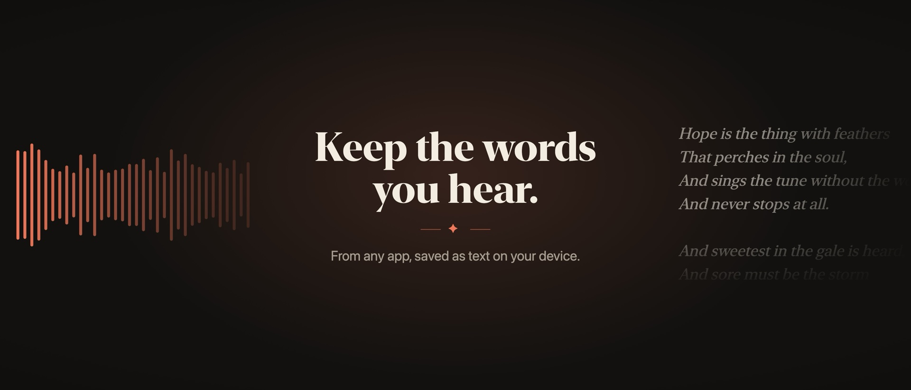
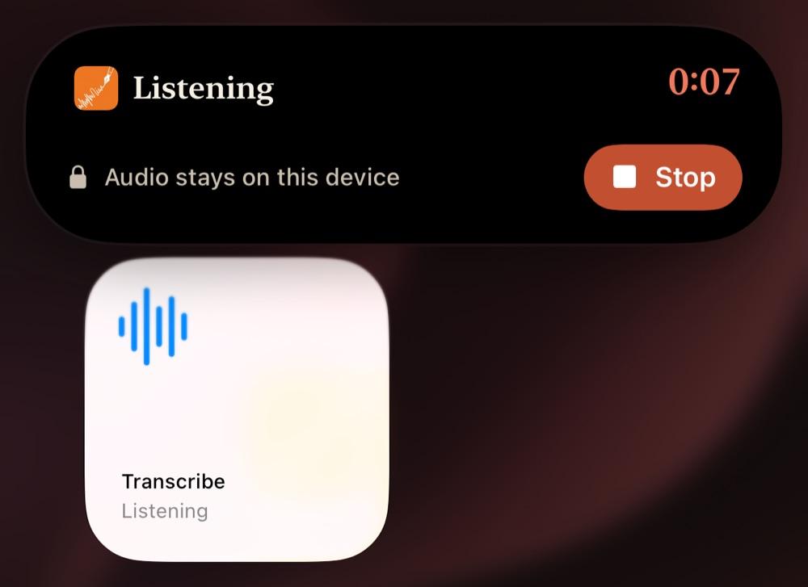
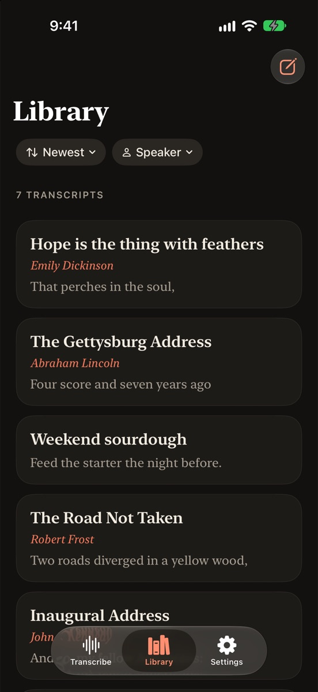
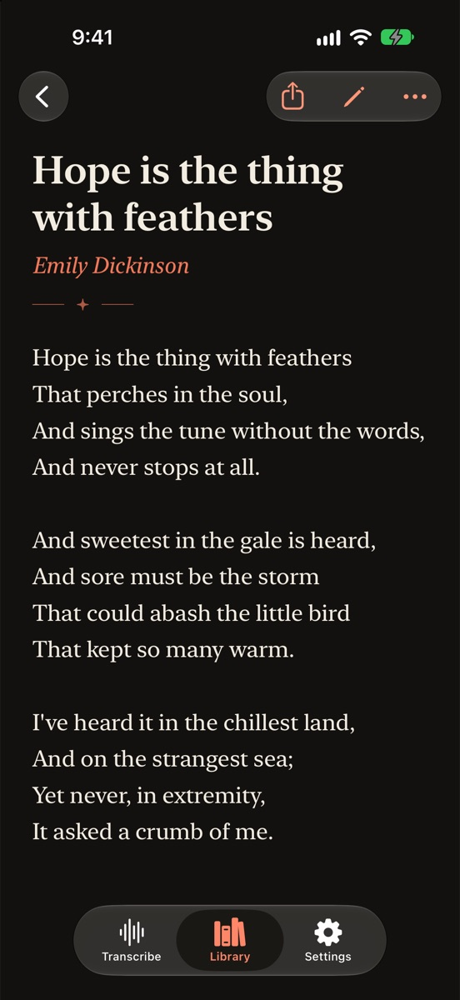
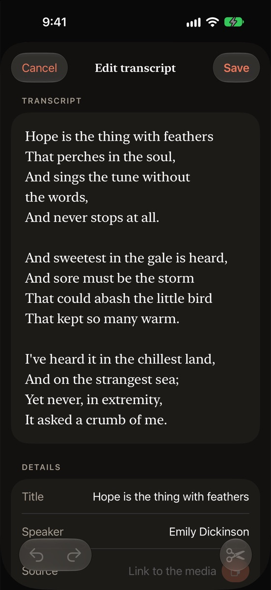
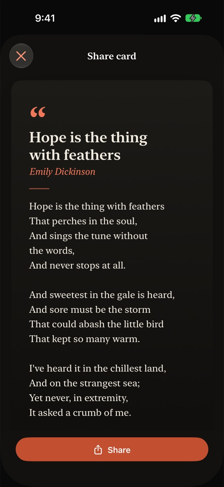
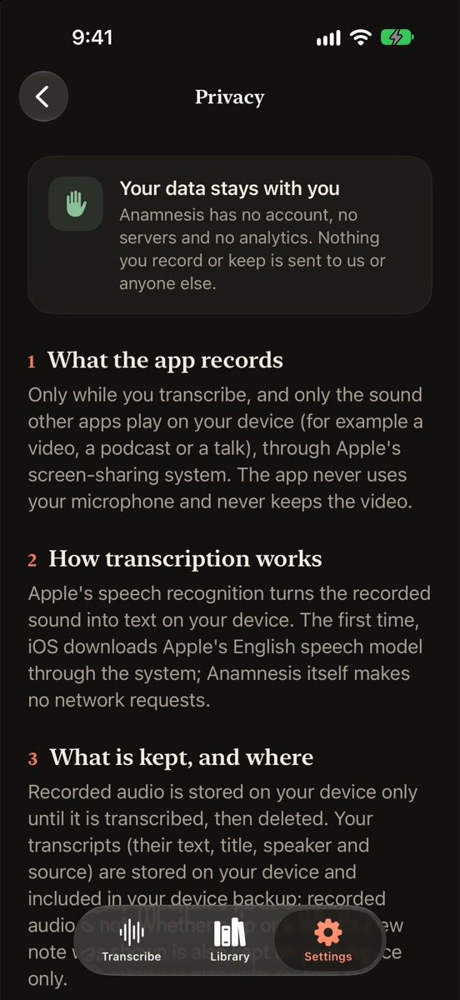
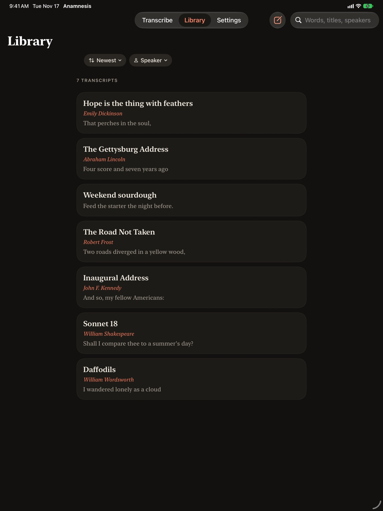

<p align="center">
  <a href="https://apps.apple.com/us/app/anamnesis-private-transcriber/id6836080299">
    
  </a>
</p>

<h1 align="center">Anamnesis</h1>

<p align="center">
  A native iOS app that turns whatever is playing on your device into text you keep — transcribed entirely on-device.
</p>

<p align="center">
  <a href="https://apps.apple.com/us/app/anamnesis-private-transcriber/id6836080299">
    
  </a>
</p>

<p align="center">
  
  &nbsp;
  
  &nbsp;
  
  &nbsp;
  
  &nbsp;
  
</p>

<p align="center">
  
</p>

---

## The Problem

I love poetry. Late at night I'd hear a few lines in a reel that stopped me mid-scroll, and by morning they were gone, buried under a hundred other videos. The caption rarely had the text, screenshots of captions were lossy, and typing a poem from audio is slow. There was no one-tap way to turn *something I just heard* into *text I own* — and I didn't want to hand my listening to a cloud service to get it. So I built Anamnesis: first for poems, now for anything you hear — speeches, stories, talks, plans.

*Anamnesis* (ἀνάμνησις) is the Greek for *recollection*.

---

## Transcribe From Any App

<table align="center"><tr>
  <td align="center"><br/><sub>Control Center control + Live Activity</sub></td>
</tr></table>

<br/>

Capture starts without leaving the app you're watching or listening in. Swipe down, tap **Transcribe**, choose *Share Entire Screen* in Apple's sheet, and go back to your media. A Live Activity shows the running time and a Stop button on the Lock Screen and in the Dynamic Island.

- One-tap **Control Center control** (also assignable to the Action Button); the system screen-sharing sheet appears over the current app, and the app never comes to the front
- Captures **only the sound other apps play** through ScreenCaptureKit — never the microphone; video frames are dropped as they arrive
- **Live Activity** with timer and Stop; stop also from the system recording indicator or the in-app orb
- Recording keeps running in the background while you scroll, switch apps, or listen with headphones
- An in-app guide detects whether the control is placed in Control Center and walks you through adding it

---

## Library

<table align="center"><tr>
  <td align="center"><br/><sub>Library</sub></td>
  <td align="center"><br/><sub>A transcript</sub></td>
  <td align="center"><br/><sub>Editing</sub></td>
</tr></table>

<br/>

Open the app after a stop and the recording is transcribed in seconds. Each stretch of speech becomes its own transcript in the Library — no review step, nothing to finish. Prune and polish there.

- Transcripts laid out line by line from the speaker's own phrasing, set in New York at a reading measure
- Full-text search across words, titles and speakers; sort and filter by speaker
- Editor with title, speaker and source link (tap the link to reopen the original media), *Split here*, and undo/redo
- Write a transcript by hand with the same editor
- Copy as plain text in one tap

---

## Share Cards & Privacy

<table align="center"><tr>
  <td align="center"><br/><sub>Share card</sub></td>
  <td align="center"><br/><sub>Privacy, in the app</sub></td>
</tr></table>

<br/>

Share a transcript as a branded card image (Paper, Night or Ember) that credits the speaker, through the system share sheet.

Privacy is a constraint of the architecture, not a setting:

- **No network code.** The app makes no requests — no accounts, analytics, crash SDKs or third-party packages. The only download is Apple's English speech model, fetched once by iOS itself.
- **Audio is ephemeral.** It lives on disk only until it is transcribed, then it is deleted, and it is excluded from backups.
- **Text stays on the device.** Transcripts live in a local SwiftData store; *Delete all data* removes everything.
- App Store privacy label: **Data Not Collected**. Full policy: [keyursavalia.com/anamnesis-privacy-policy.html](https://www.keyursavalia.com/anamnesis-privacy-policy.html)

---

## iPad

<p align="center">
  
</p>

The same app on iPad, with a reading-width layout for the library and transcripts, and the Live Activity banner while listening.

---

## How It Works

```
 another app plays audio
          │
          ▼
 ScreenCaptureKit SCStream (in the app, `screen-capture` background mode)
          │  CMSampleBuffer (.audio) — video frames ignored
          ▼
 Real-time ingest → preallocated ring buffer (drop-and-count, never blocks)
          │
          ▼
 Segmented spool writer → 16 kHz mono Int16 CAF, 60-second segments + manifest
          │  crash-tolerant: a killed app recovers its segments on next launch
          ▼
 SpeechAnalyzer + SpeechTranscriber (on-device) → timed results
          │
          ▼
 MomentSegmenter (≥ 3 s pauses) + line breaks from result boundaries
          │
          ▼
 SwiftData library → audio deleted
```

**Capture.** ScreenCaptureKit became available on iOS 27. The app presents `SCContentSharingPicker` — from the Control Center control it does so over the current app, without bringing Anamnesis forward, even from a cold launch — and keeps only the `.audio` output. The `screen-capture` background mode keeps the stream alive while the user is in another app.

**Real-time path.** Sample callbacks arrive on an arbitrary queue. They copy PCM into a preallocated ring buffer and return — no `await`, no locks across I/O, no per-buffer allocation, no main-actor hops. A writer drains the ring, converts to 16 kHz mono Int16 and rotates 60-second CAF segments, so a crash loses at most the unflushed tail.

**Transcription.** After a stop, the app feeds the spool as one continuous timeline to `SpeechAnalyzer` with `SpeechTranscriber`. Results carry audio time ranges, which split the session into Moments at pauses and into lines at result boundaries. Each Moment is saved as a transcript and the audio is deleted.

**Launch.** A `ControlWidgetToggle` runs a background `SetValueIntent` in the app process; an in-process mailbox hands the command to the capture controller, and a `LiveActivityIntent` starts the activity in the same window. Control state is mirrored through an App Group so the switch stays truthful after a stop from the system indicator.

The design was validated with on-device experiments before any product UI was written: whether third-party audio reaches app code, stability and memory over long sessions, spool fidelity, transcript quality (word error rate on a small public-domain corpus), and taps-to-capture.

---

## Tech Stack

| | |
|---|---|
| Language | Swift 6 (strict concurrency; `MainActor` default isolation in the app, `nonisolated` in the package) |
| UI framework | SwiftUI, with a small design system (`Theme`, shared components) |
| Capture | ScreenCaptureKit (`SCStream`, `SCContentSharingPicker`) |
| Speech | Speech framework — `SpeechAnalyzer`, `SpeechTranscriber`, `AssetInventory` |
| Persistence | SwiftData (versioned schema) |
| System surfaces | WidgetKit Control Center control, ActivityKit Live Activity, App Intents, TipKit |
| Logging | `os.Logger` plus an on-device ring-buffer file log |
| Deployment target | iOS 27+ (iPhone and iPad) |
| Third-party packages | None |

---

## Project Structure

```
Anamnesis/
├── Anamnesis/                       # App target
│   ├── App/                         # Entry point, dependency container, root tabs
│   ├── Core/
│   │   ├── Capture/                 # ScreenCaptureKit backend, picker, capture controller
│   │   ├── Launch/                  # Control/intents mailbox, Live Activity controller, control sync
│   │   ├── Transcription/           # SpeechAnalyzer glue, model assets, transcription queue
│   │   ├── Spool/                   # Session ingestion
│   │   ├── Persistence/             # SwiftData library store
│   │   └── Logging/
│   ├── Design/                      # Theme tokens, components, app mark
│   └── Features/
│       ├── Listen/                  # The Transcribe tab: orb, status, model banner
│       ├── Library/                 # List, search, filters, transcript page
│       ├── Poems/                   # Transcript editor
│       ├── ShareCard/               # Branded card image + share sheet
│       ├── Onboarding/              # Welcome
│       ├── ControlSetup/            # Control Center guide, tips
│       ├── WhatsNew/                # Offline What's New sheet
│       ├── Settings/                # Settings, About, Privacy, Terms
│       └── Lab/                     # DEBUG-only experiment harness (absent from Release)
│
├── AnamnesisControls/               # Widget extension: Control Center control + Live Activity
│
└── Packages/AnamnesisKit/           # Local Swift package — pure logic shared by app and extension
    ├── Sources/AnamnesisKit/
    │   ├── Audio/                   # Format info, level math, real-time ingest pipeline
    │   ├── Spool/                   # Segmented writer, manifest, reader, recovery, retention
    │   ├── Transcription/           # Segments, Moments, line breaks, hallucination flags, WER
    │   ├── Library/                 # SwiftData schema, importer, search filter, editing, export
    │   ├── Diagnostics/             # Probe reports, memory sampling, file log
    │   ├── Eval/                    # Transcript-quality corpus and scoring
    │   └── Shared/                  # Identifiers, launch links, control and activity state
    └── Tests/AnamnesisKitTests/
```

The code still calls a transcript `Poem` and a speaker `poet` — the app began as a poetry notebook, and the stored schema kept its names when it grew into a general transcriber.

---

## Tests

All logic that can run without a device lives in `AnamnesisKit` and is tested with Swift Testing (`@Suite`, `@Test`, `#expect`): **192 tests in 35 suites**.

| Area | What it covers |
|---|---|
| **Audio** | Level and silence math; format descriptors; the real-time ingest pipeline — buffers split across boundaries lose and duplicate nothing |
| **Spool** | Segment rotation; a full inbox drops and counts without blocking the producer; clipping is clamped and counted; manifest encoding; reader cursors across segments; crash recovery from truncated files (property-style); retention and deletion |
| **Transcription** | Transcript segments and timing; Moment segmentation at pauses; line breaking and its scoring; hallucination heuristics; text normalization; word and character error rate |
| **Library** | Store import (idempotent upserts); search and speaker filters; editing and split; plain-text export; source-link detection; keeping Moments as transcripts |
| **Launch & state** | Capture launch links and mailbox; control state shared through the App Group; Live Activity phases and stale dates; capture session state and audio retention |
| **Diagnostics** | Probe reports, memory sampling, the file ring-buffer log, app data file listing |

Capture, background behaviour, Live Activities and transcript quality depend on a physical device and real audio; those were verified in recorded device runs rather than automated tests.

### Running the Tests

```bash
swift test --package-path Packages/AnamnesisKit
```

or, on the iOS Simulator:

```bash
cd Packages/AnamnesisKit
xcodebuild test -scheme AnamnesisKit -destination 'platform=iOS Simulator,name=iPhone 17'
```

---

## Getting Started

**Requirements:** Xcode 27 and a physical iPhone or iPad on iOS 27. The simulator builds and runs the UI, but it has no ScreenCaptureKit, so capture needs a device.

```bash
git clone https://github.com/keyursavalia/Anamnesis.git
cd Anamnesis
open Anamnesis.xcodeproj
```

1. Select your development team for the `Anamnesis` and `AnamnesisControlsExtension` targets.
2. Change the bundle identifiers and the App Group to ones your team owns — in both targets' *Signing & Capabilities* and in `Packages/AnamnesisKit/Sources/AnamnesisKit/Shared/AppIdentifiers.swift`.
3. Run on a device. On first launch iOS downloads the English speech model once (internet needed for that step only).

There are no API keys, no backend and no packages to resolve. Debug builds add a **Lab** tab with the experiment harness (capture probes, spool inspector, transcription bench, transcript-quality evaluation).

---

## What's Next

- **More languages** — the pipeline is locale-driven; the UI and model download currently target English
- **First line at stop** — show the transcript's opening line in the Live Activity right after a stop
- **Spotlight** — index transcripts on-device so they appear in system search
- **Duplicate detection** — notice when the same words are captured twice

---

## Contributing

Fork the repo, create a branch off `main`, and open a pull request. One fix or feature per PR keeps review tractable. Bug reports and ideas are welcome as GitHub issues. Two rules are non-negotiable: no network code, and nothing on the real-time audio path that can block.

---

## License

[MIT](LICENSE) · © 2026 Keyur Savalia
